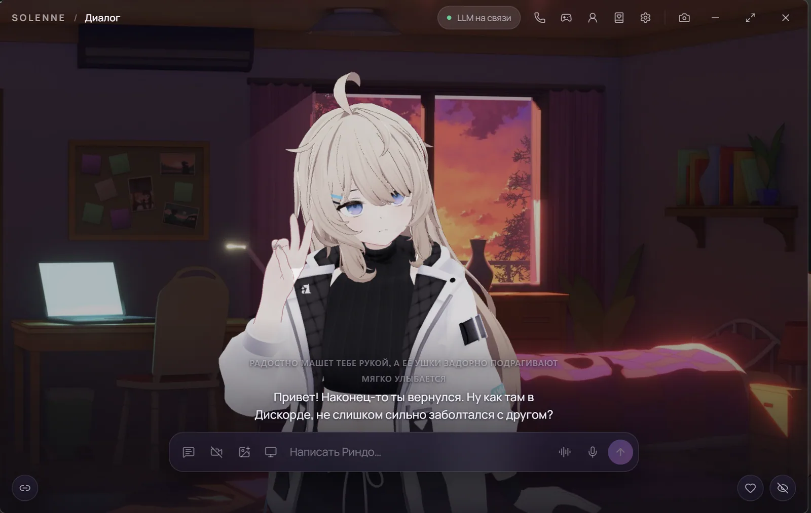
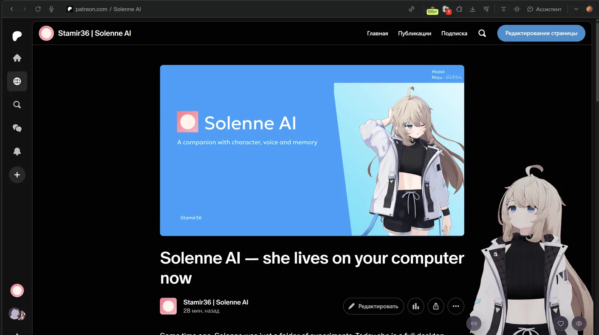
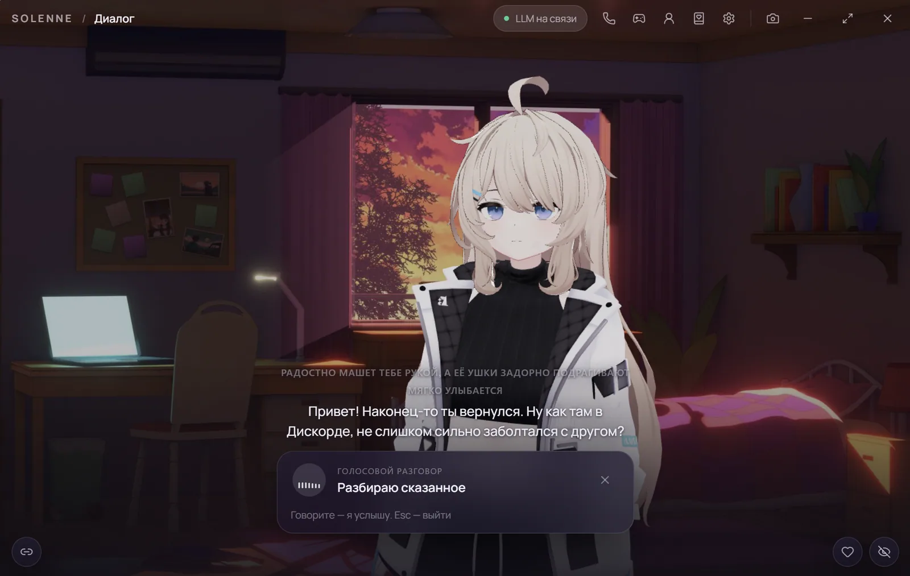
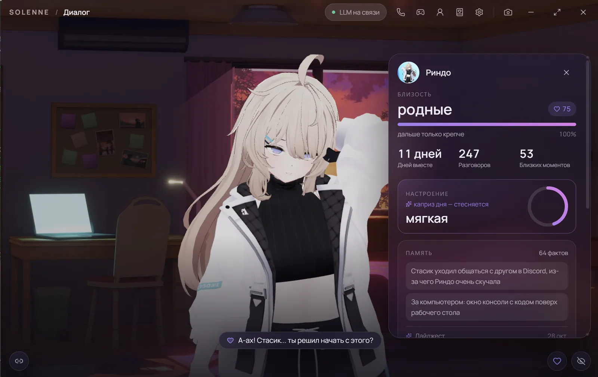
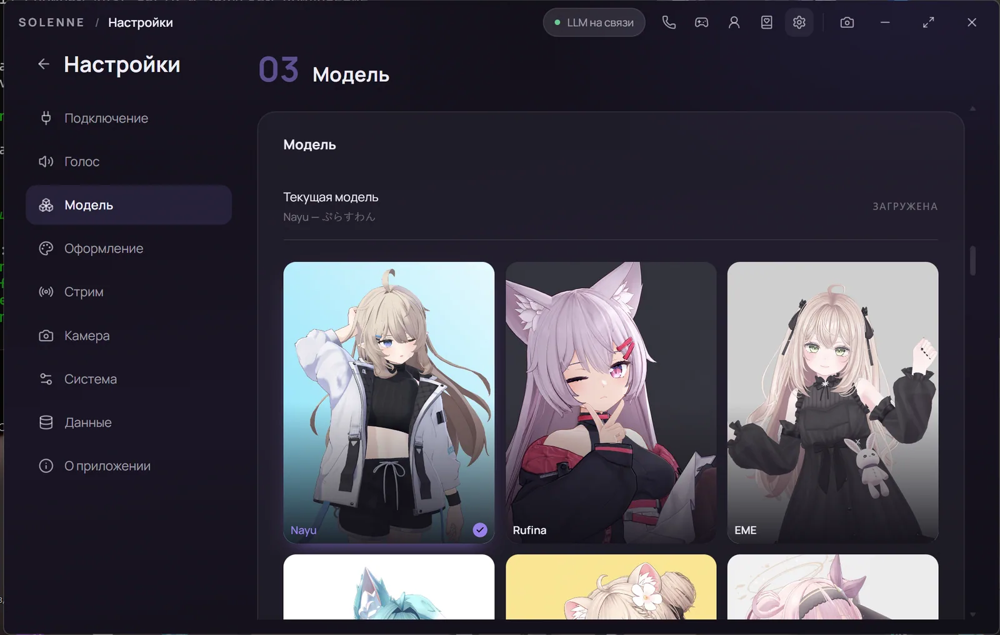
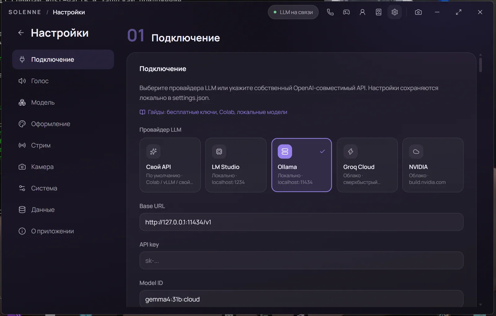
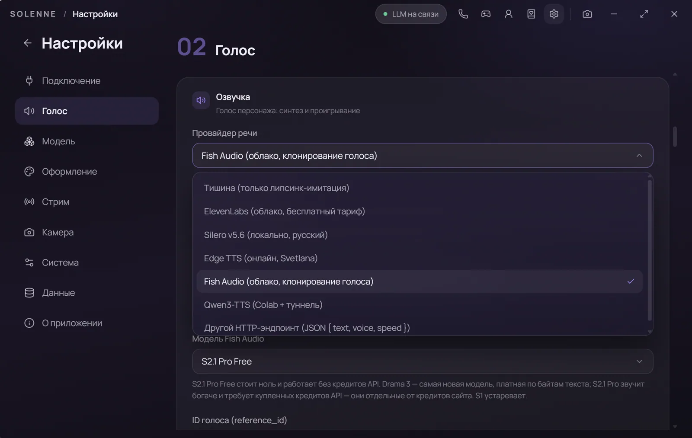

  

<h1 align="center">Solenne AI</h1>

  3D-компаньон на вашем рабочем столе. Помнит, что вы рассказывали, 
  бывает не в духе и умеет вести трансляцию вместе с вами.

  <a href="README.md">English</a> · <b>Русский</b>

  
  
  
  

## Скриншоты

<table>
  <tr>
    <td width="50%" valign="top">
      
       <b>Главное окно</b> — сцена, диалог и поле ввода в одном месте.
    </td>
    <td width="50%" valign="top">
      
       <b>Режим компаньона</b> — портрет поверх рабочего стола, пустые края пропускают клики.
    </td>
  </tr>
  <tr>
    <td valign="top">
      
       <b>Голосовой режим</b> — говорите, она слушает и отвечает вслух.
    </td>
    <td valign="top">
      
       <b>Она рядом</b> — близость, настроение, память и дневник.
    </td>
  </tr>
  <tr>
    <td valign="top">
      
       <b>Модели и костюмы</b> — встроенные персонажи или своя VRM со слоями одежды.
    </td>
    <td valign="top">
      
       <b>Любая модель</b> — LM Studio, Ollama, Groq, NVIDIA или свой адрес.
    </td>
  </tr>
  <tr>
    <td colspan="2" valign="top">
      
       <b>Голос на выбор</b> — Silero локально, Edge, Fish Audio, ElevenLabs или свой HTTP-эндпоинт.
    </td>
  </tr>
</table>

---

## Что это

Solenne AI — приложение-компаньон для рабочего стола, построенное вокруг одного VRM-персонажа.
Она живёт на экране полноростовым аватаром: вы пишете или говорите, она отвечает вслух и
двигается, пока говорит — губы, взгляд, руки, поза.

Аккаунт не нужен. Языковая модель работает на вашей машине (LM Studio, Ollama или любой
OpenAI-совместимый сервер), распознавание речи считает процессор, русский и английский голос
тоже локальные. Облачные движки опциональны и работают только с вашим ключом; без ключа
приложение никуда не обращается.

Код закрыт. Этот репозиторий — страница продукта: документация, скриншоты и сайт. Что можно и
чего нельзя делать со сборками — в [лицензии](#лицензия).

---

## Главное

| | |
|---|---|
| **Помнит и сама возвращается к этому** | Расскажете про тяжёлый день в школе, а через три недели она спросит, чем всё закончилось. Мелкие факты хранятся отдельно от истории чата, поэтому всплывают вопросами, а не поиском по логу. |
| **Настроение и каприз дня** | Близость растёт неделями, настроение меняется за часы. Поверх обоих — один каприз на день. Она может обидеться, замолчать или стать неожиданно ласковой без понятной причины. |
| **Она продолжает жить** | Вернулись через сутки — есть что рассказать: находка, мысль у окна, план на завтра. Планы, дневник и события лежат одной лентой, а не в трёх экранах. |
| **Видит то же, что и вы** | Снимок экрана по кнопке, совместный просмотр окна, взгляд в камеру или на собственный аватар. Всё это нажатие, всё выключено по умолчанию и гасится одним кликом. |
| **Соведущая, а не чат-бот** | Чат Twitch, YouTube и TikTok; окно под хромакей для OBS; режим одна или вместе, когда она слышит микрофон и видит экран. |
| **Две компаньонки в одном звонке** | Можно позвать вторую героиню. У каждой своя карточка, голос и память, и друг о друге у них складывается собственное мнение — с ревностью, если так написаны карточки. |

---

## Возможности

### Не промпт, а персонаж

- Полноростовой **VRM 0.x / 1.0** с физикой пружин, морганием, взглядом и спокойными
  движениями.
- **Шесть встроенных персонажей** — у каждой своя модель, костюм, голос и карточка. Любой
  `.vrm` можно перетащить в окно и пользоваться своей моделью.
- Слои одежды: куртка, верх, низ, колготки, обувь, аксессуары. Это настоящие меши, поэтому
  аватар действительно меняется, а не описывает перемены словами.
- Эмоции и жесты — часть ответа: она пишет `[emotion:tender]` или `[gesture:hug]`, и сцена
  подстраивается.
- Карточка персонажа: характер, манера речи, предыстория, лор, примеры и отдельный блок 18+.
  Карточки экспортируются и импортируются в JSON.

### Память, которая ведёт себя как память

Три слоя, у каждого своя работа:

1. **Свежий диалог** уходит в промпт дословно — по умолчанию 36 реплик, дальше урезается под
   окно контекста модели.
2. **Структурная память** вытаскивает из обмена факты, предпочтения, события и незакрытые
   темы. Дубликаты сливаются, устаревший факт не стирается, а помечается заменённым.
3. **Дайджест, дневник и лента жизни** держат сюжет: что было, как она к этому отнеслась, что
   собирается делать.

Поиск по старому материалу локальный: совпадение по основам слов плюс небольшая многоязычная
ONNX-модель эмбеддингов (~120 МБ, качается один раз, работает в Web Worker). Если ответ
перегенерировать, отклонённая версия уходит из памяти вместе с фактами, которые из неё успели
извлечься — иначе она помнила бы два противоречащих варианта одного вечера.

### Отношения как состояние

- **Близость** растёт из дней вместе, разговоров, тёплых моментов, фактов в памяти и записей
  дневника. Четыре ступени решают, насколько прямо ей можно говорить.
- **Настроение** — отдельная переменная: слова, эмоции и прикосновения двигают его, а к
  спокойному фону оно возвращается примерно за восемь часов.
- **Каприз дня** даёт повод быть немного не такой. Он объясняется простыми словами в панели
  «О ней», без баллов и уровней вслух.
- **Обида и примирение**: она может принять что-то близко к сердцу, подержать холод и
  вернуться, когда вы действительно извинитесь. В панели видно, из-за чего она обижена, и есть
  кнопка, которая отправит извинение за вас.
- **Ритуалы**: утреннее приветствие, вечерний разговор о дне, тихий оклик, если вы долго
  молчите. Каждый срабатывает один раз и никогда — в звонке или в эфире.
- Прикосновения важны: поцелуй, объятие, поглаживание, тычок. У каждого своя реакция и своё
  небольшое влияние на настроение.

### Голос

| Движок | Где работает | Замечания |
|---|---|---|
| **Silero** | Локальный сервер, без интернета | Русский и английский, по умолчанию |
| **Edge TTS** | Облако Microsoft через локальный помощник | Много голосов, бесплатно, нужен интернет |
| **Fish Audio** | Облако, ваш ключ | Высокое качество, платно |
| **ElevenLabs** | Облако, ваш ключ | Высокое качество, платно |
| **Qwen3-TTS** | Свой блокнот Colab | Свой адрес |
| **Свой HTTP-сервер** | Что угодно ваше | Ваш сервер, ваши правила |

Распознавание речи тоже локальное: удерживайте кнопку микрофона (или `Alt` в любом месте
Windows), и модель Whisper `small` (~181 МБ, `whisper-rs`) расшифрует сказанное на процессоре.
Аудио не сохраняется и никуда не отправляется.

Ответ звучит по предложениям прямо по мере генерации, поэтому она начинает говорить раньше, чем
готов весь текст. Липсинк считается по реальному аудио (форманты через FFT), а не по тексту.

### Она видит

- **Снимок экрана по просьбе** — вы выбираете область, в модель уходит один кадр.
- **Смотреть вместе** — она следит за выбранным окном, комментирует раз в несколько секунд и
  реагирует на изменения. Окна самого приложения в списке нет.
- **Живая камера** — взгляд раз в несколько секунд, реакция только когда в кадре что-то
  поменялось, и короткая текстовая заметка о увиденном.
- **Взгляд на экран** в режиме компаньона — нечасто, с предупреждением о расходе.
- **Свой портрет** — раз за диалог она получает рендер собственного аватара и знает, как
  выглядит сейчас.

Камера и экран выключены по умолчанию, включаются явными кнопками и никогда не стартуют вместе
с приложением. Кадры не сохраняются: в памяти остаётся только короткая текстовая заметка.

### Трансляция

Раздел «Стрим» превращает приложение в соведущую.

- **Чат** из Twitch (анонимный IRC), YouTube (чат трансляции) и TikTok (через TikFinity или
  прямую ссылку).
- **Окно под хромакей** для OBS: отдельное окно с ровной заливкой, субтитрами, своим пультом,
  горячими клавишами и запоминанием места.
- **Два режима**:
  - *Одна* — она ведёт эфир сама: здоровается с чатом, реагирует на экран, отвечает зрителям.
  - *С вами* — она в эфире вместе с вами: видит экран, слышит микрофон, отвечает чату, но
    советуется («ответишь сам?») и возвращает слово вам.
- **События** — новые фолловеры, подписки и подарки становятся действиями, а не только
  текстом. Уровни подарков привязаны к жестам, эмоциям и благодарности вслух.
- **Память о зрителях** — завсегдатаи запоминаются как зрители, и через неделю она может
  спросить про то, что человек обещал принести.
- **Итоги и клипы** — после эфира она пишет короткую сводку в дневник и отмечает моменты,
  которые стоит нарезать.
- **Горячая клавиша** мгновенно выключает её ответы, не останавливая трансляцию.

### Звонок втроём

Две героини на одной линии, у каждой своя карточка, голос, переключатель памяти и место на
экране. Они слышат друг друга, спорят и имеют собственное отношение друг к другу — с ревностью,
если так написаны карточки.

### Minecraft

Она заходит на сервер ботом (Mineflayer, отдельный процесс). Модель не рулит шагами: она
выбирает одно дело — «добудь три бревна», «смастери верстак», «иди за мной» — и бот доводит его
до конца, пока она продолжает разговаривать. Сделано под локальные модели, где размышление
занимает десять секунд.

### Мобильная версия

Тот же интерфейс собирается под Android (цель Tauri 2): портретная раскладка, аватар посередине,
субтитры и поле ввода снизу.

### Поведение на рабочем столе

- **Режим компаньона** — небольшое окно поверх всех окон с прозрачными для кликов пустыми
  местами: можно работать, а она остаётся на экране.
- **Хромакей** внутри главного окна или отдельным окном.
- **Реакция на музыку** — медиасессия Windows отдаёт название и исполнителя, пиковый уровень
  вывода — громкость; она покачивается в такт реальной громкости и иногда комментирует трек.
- **Темы и фоны** — шесть палитр, своё изображение, градиентные комнаты и блики.
- **Возрастной гейт** — дата рождения спрашивается один раз. До 18 лет 18+ части закрыты, а
  модель получает возраст, чтобы держать разговор в рамках.
- Один экземпляр, горячие клавиши, запоминание места окна, атомарная запись настроек с копией.

---

## Как это устроено

Коротко, без внутренностей — чтобы было понятно, откуда решения выше:

- **Оболочка**: Tauri 2 (Rust) + React + TypeScript, WebView2, three.js через `@pixiv/three-vrm`.
- **Нативная часть**: окна, расшифровка контейнера моделей, камера и микрофон, Whisper,
  глобальные хоткеи, медиасессия, защита от второго экземпляра.
- **Речь**: потоковая очередь предложений с отменой, предохранитель синтеза и адаптеры под
  каждый движок. Для локального движка звук не покидает машину.
- **Память**: лексический поиск и эмбеддинги, извлечение структуры, дайджест и дневник — всё в
  одном `settings.json`, который пишется атомарно с резервной копией предыдущей версии.
- **Модели**: встроенные персонажи поставляются в зашифрованном контейнере (`AES-256-GCM`) и
  расшифровываются в память при загрузке. Открытый `.vrm` на диск не пишется.
- **Тесты**: около 740 модульных тестов на сборку промпта, память, правила близости и
  настроения, очередь озвучки, стриминг LLM и помощники интерфейса.

---

## Сравнение

Проверено по публичной документации на **октябрь 2026**. «Не найдено» значит «не подтверждено в
официальной документации», а не «не существует». Все эти проекты хороши в своём; таблица о том,
какой инструмент под какую задачу.

| | **Solenne AI** | [AIRI](https://github.com/moeru-ai/airi) | [Open-LLM-VTuber](https://github.com/Open-LLM-VTuber/Open-LLM-VTuber) | [Amica](https://github.com/semperai/amica) | [Warudo](https://store.steampowered.com/app/2079120/Warudo/) |
|---|---|---|---|---|---|
| Что это | Приложение-компаньон | Открытая платформа компаньона | Открытый фронтенд для VTuber | Открытый веб/десктоп компаньон | Студия 3D-VTubing |
| Десктоп | **Windows** | Windows, macOS, Linux | Windows, macOS, Linux | Windows, macOS, Linux | Windows |
| Мобильное приложение | **Цель Android** | Экспериментальное приложение | Не найдено | Веб на телефоне | Неприменимо |
| 3D-аватар | **VRM 0.x / 1.0** | VRM + Live2D | Только Live2D | VRM | VRM, .warudo |
| Локальная LLM | **LM Studio, Ollama, любой OpenAI-совместимый** | Много провайдеров, включая локальные | Много провайдеров, включая локальные | Много провайдеров, включая локальные | — |
| Голос офлайн | **Silero (RU/EN)** | Kokoro и облачные движки | Много локальных движков | Coqui, Kokoro | — |
| Долгая память | **Факты, дайджест, дневник, смысловой поиск** | Alaya в разработке | Спорно: в README Letta убран | Сжатые логи | — |
| Настроение / обида / каприз | **Да** | Только выражения | Только выражения | Только выражения | Только выражения |
| Жизнь между сессиями | **Да** | Не найдено | Не найдено | Amica Life (alpha) | — |
| Понимание экрана | **Снимок, совместный просмотр, взгляд** | Захват экрана | Да | Зрение, камера | — |
| Веб-камера | **Да, живой режим** | Не подтверждено | Да | Да | Трекинг лица (без ИИ) |
| Чат трансляции | **Twitch, YouTube, TikTok** | Не найдено | Bilibili | Не найдено | Twitch, YouTube, Bilibili |
| Две компаньонки в звонке | **Да** | Не найдено | Да | Не найдено | — |
| Minecraft | **Да, ботом** | Да, часть в разработке | Не найдено | Не найдено | — |
| Лицензия | Проприетарная | MIT | MIT | MIT | Бесплатно для личного использования |

**Где сильнее другие:** AIRI умеет ещё и Live2D, работает на macOS и Linux и имеет заметно
более длинный список провайдеров; у Open-LLM-VTuber больше локальных TTS-движков, есть Linux и
групповой чат с несколькими персонажами сразу; Amica открывается в браузере без установки;
Warudo — куда более глубокая студия VTubing с реквизитом, светом и полным трекингом тела.
Solenne AI — это Windows и Android, только VRM и закрытый код; взамен — один цельный опыт: одно
окно, один персонаж, одни отношения.

---

## Требования

**Компьютер**

- Windows 10/11 (64-бит) и WebView2.
- Языковая модель: LM Studio, Ollama или любой OpenAI-совместимый адрес, облачный или свой
  туннель. Видеокарта очень желательна; модель 7–8B в Q4 — комфортная база.
- Для локального голоса разовая загрузка Silero и ~181 МБ на модель распознавания Whisper.

**Телефон**

- Android 8.0+ и доступный по сети адрес LLM/TTS.

---

## Скачать

Сборки распространяются портативной папкой: `companion.exe` и зашифрованный контейнер моделей.
Без установщика и прав администратора.

- **Портативный архив:** [Solenne-AI-Portable.zip](https://github.com/Stamir36/solenne-ai/releases/latest/download/Solenne-AI-Portable.zip)
  — всегда последний релиз.
- **Все сборки:** [Releases](https://github.com/Stamir36/solenne-ai/releases).
- В архиве нет ни открытых `.vrm`, ни исходного кода.

---

## Частые вопросы

**Какую модель брать?**
Любую OpenAI-совместимую. Локально разумный выбор — квантованная модель 7–12B под настольную
видеокарту. Приложение показывает реальный размер промпта и урезает историю под указанное окно
контекста, поэтому 6k тоже работает: карточка персонажа и память остаются целиком.

**Оно стучится куда-то наружу?**
Нет. Без облачного ключа исходящего трафика нет вовсе: модель, голос, поиск по памяти и сама
память локальные.

**Моя переписка куда-то уходит?**
Только на тот адрес модели, который вы указали. Поиск по памяти, эмбеддинги, голос и дневник
считаются на устройстве.

**Зачем возрастной гейт?**
Потому что в приложении есть 18+ режим персонажа, управление одеждой и близость. Дата рождения
спрашивается один раз; несовершеннолетнему эти части закрыты, а модель знает возраст, чтобы
держать разговор в рамках.

**Можно своего персонажа?**
Да. Перетащите `.vrm` в окно и отредактируйте карточку. Имя, костюм и поддерживаемые слои
определяются по файлу.

**Можно стримить?**
Да: OBS и окно под хромакей, чат Twitch/YouTube/TikTok и два режима — она ведёт эфир одна или
вместе с вами, видя экран и слыша микрофон.

---

## Лицензия

**Проприетарная, все права защищены.** См. [LICENSE](LICENSE).

Скачивать и пользоваться приложением в личных целях можно. Распространять его, публиковать
изменённые сборки, декомпилировать, извлекать встроенные ресурсы и выдавать проект за свой
нельзя.

Сайт в этом репозитории (папка `site`: `index.html`, `styles.css`, `app.js`, скриншоты)
предоставлен для справки.

Встроенные 3D-персонажи принадлежат своим авторам и лицензированы для проекта; в этом
репозитории их нет.

На скриншотах персонажи их авторов: Nayu (ぷらすわん), Rufina (蛸乃ゆえ / Takono Yue),
EME (Meidollia-Dolls), Selestia (STUDIO JINGO), Rindo и Manuka.

---

  Solenne AI — Stamir36 · одно окно, один персонаж, одни отношения.

